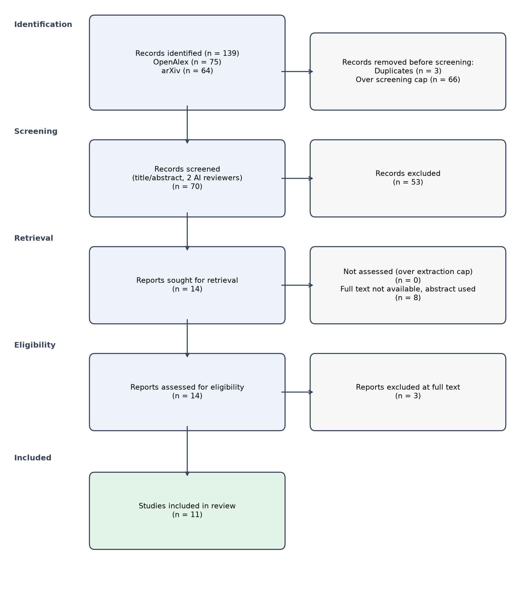

# Systematic Review: What is the effect of generative AI tools on human creativity and entrepreneurial competencies?

*Automatically generated by the sr-agent multi-agent pipeline on 2026-11-12 (run `20261112-155525`).
All decisions are logged in `audit.jsonl`. This draft must be checked by human reviewers.*

## 1. Methods

**Protocol (PICOC).** Population: Individuals (students, professionals, entrepreneurs) engaged in creative or entrepreneurial activities. Intervention: Use of generative AI tools (e.g., ChatGPT, DALL·E, Midjourney, Stable Diffusion) as a support or co‑creation aid.
Comparator: none / not required (studies may use pre‑post designs, within‑subject comparisons, or no comparison group). Outcomes: Measures of creative performance (e.g., originality, fluency, flexibility, elaboration), Entrepreneurial competency scores (e.g., opportunity recognition, risk tolerance, resource mobilization), Self‑reported creativity or entrepreneurial self‑efficacy, Quality or novelty of generated artefacts/products. Context: Educational, workplace, or startup environments where generative AI tools are applied to creative or entrepreneurial tasks.
Eligible designs: Randomized controlled trial, Quasi‑experimental pre‑post study, Observational cohort or cross‑sectional survey, Case study or mixed‑methods investigation, Simulation or laboratory experiment. Years: 2020-present.

**Inclusion criteria:**
- Empirical primary research reporting quantitative or qualitative data on the impact of generative AI tools
- Participants are humans using the AI tool for creative or entrepreneurial tasks
- The study includes at least one of the specified outcomes (creativity or entrepreneurial competencies)
- The intervention explicitly involves a generative AI system (text, image, audio, video generation)
- Published in a peer‑reviewed journal, conference proceeding, or reputable scholarly outlet
- Full text available in English

**Exclusion criteria:**
- Editorials, opinion pieces, commentaries, or reviews without original data
- Studies focusing solely on AI performance without measuring human outcomes
- Non‑English language publications
- Papers that do not involve a generative AI tool (e.g., only predictive AI or traditional software)
- Research on non‑human subjects (e.g., animal studies, purely algorithmic evaluations)
- Duplicate reports of the same dataset without new analysis

**Information sources and search.** Databases: openalex, arxiv. Search date: 2026-11-12. Queries:
  - `generative AI creativity`
  - `generative AI entrepreneurship`
  - `ChatGPT students`

**Selection process.** Records were deduplicated (DOI, PMID and fuzzy title matching), then screened on
title and abstract by two independent LLM reviewers (groq:openai/gpt-oss-120b and groq:openai/gpt-oss-20b)
with different prompts. Disagreements and uncertain cases were resolved by an adjudicator agent.

**Data extraction.** Open-access full texts were retrieved when available (otherwise the abstract was used),
split into passages and searched with BM25 keyword retrieval (dense embeddings not available with this LLM provider).
Each extracted value cites the passage ids it was taken from.

**Quality appraisal.** A simplified checklist inspired by the Mixed Methods Appraisal Tool (MMAT).

**Synthesis.** Narrative synthesis following SWiM, reviewed by a critic agent
(3 review round(s)). No meta-analysis was performed.

## 2. Results

### 2.1 Study selection

139 records were identified, 3 duplicates removed and
70 records screened. Inter-reviewer agreement: Cohen's kappa = 0.679
(raw agreement 0.857; 12 records adjudicated).
11 studies were included (6 with full text).

### 2.2 Study characteristics

| Key | Study | Design | Sample / data | AI method | Effect | Quality | Evidence |
|---|---|---|---|---|---|---|---|
| S1 | Anil Rajnikant Doshi (2024) | randomized experiment | not reported | large language model (LLM) providing story ideas | mixed | moderate | S1-c0 |
| S2 | Ricardo Maia Avelino (2026) | preliminary qualitative study (expert case study) | 3 expert participants (architecture, structural engineering, parametric modelling) | Google Gemini 3.1 Flash‑Lite (generative AI reasoning model) integrated in a multimodal design interface | positive | low | S2-c1, S2-c11, S2-c13, S2-c20, S2-c23, S2-c24 |
| S3 | Haidan Liu (2026) | user study (within‑subjects experimental) | 17 participants (6F/10M/1 gender‑non‑conforming) from various creative professions | OpenArt AI (text‑to‑image and image‑to‑image generation) | mixed | moderate | S3-c28, S3-c36, S3-c39, S3-c53, S3-c54 |
| S4 | Sultan A. Alharthi (2025) | mixed-method study (online survey and interviews) | online survey participants (n = 42) and interviewees (n = 9) | generative AI tools used in game design | mixed | moderate | S4-c0 |
| S5 | Safinah Ali (2021) | randomized experiment | adult participants fluent in English; 362 stories analyzed (exact participant count not reported) | generative visual algorithms (BigGAN, VQGAN, DALL‑E, CLIPDraw) combined with CLIP | mixed | high | S5-c0, S5-c2, S5-c3, S5-c4, S5-c5 |
| S6 | David Zhou (2024) | experimental study | 27 participants (self‑identified creative writers, average age 22.7) | generative AI writing assistant providing fluent continuations and intermediate suggestions designed to encourage rewriting | positive | moderate | S6-c5, S6-c22, S6-c40, S6-c41, S6-c53 |
| S7 | Rida Qadri (2024) | qualitative case study | 3 artists and 3 expert commentators (participants recruited via snowball sampling) | generative image models (e.g., MidJourney, DALL‑E, Adobe Firefly, Stable Diffusion, Google Colab) | positive | low | S7-c0, S7-c7, S7-c9, S7-c10, S7-c13, S7-c19 |
| S8 | Qi Zhao (2026) | pilot/early-stage exploratory study (qualitative, workshop-based) | Workshop attendees (N=14) who used the BizChat AI‑powered business‑planning tool | BizChat – an AI‑generated business‑plan generator with an evaluation module linking claims to user input | positive | moderate | S8-c0, S8-c4, S8-c1 |
| S9 | Shaofeng Wang (2025) | mixed-method (survey and interviews) | 206 hotel marketers (survey participants) | generative AI tools integrated into marketing workflows | positive | moderate | S9-c0, S9-c1 |
| S11 | Vlad Demsar (2025) | qualitative interview study | senior advertising executives (n not reported) | generative AI tools for advertising creative work | mixed | low | S11-c0 |
| S13 | Rina Herani (2026) | survey | 549 respondents | generative AI (ChatGPT) | mixed | moderate | S13-c0 |

### 2.3 Quality appraisal

| Key | Clear aims | Design | Sample/data | Outcome measures | Limitations | Overall |
|---|---|---|---|---|---|---|
| S1 | yes | yes | unclear | unclear | no | moderate |
| S2 | yes | yes | no | unclear | yes | low |
| S3 | yes | yes | yes | yes | yes | moderate |
| S4 | yes | yes | yes | unclear | no | moderate |
| S5 | yes | yes | yes | yes | yes | high |
| S6 | yes | yes | yes | yes | yes | moderate |
| S7 | yes | yes | no | unclear | no | low |
| S8 | yes | yes | no | yes | unclear | moderate |
| S9 | yes | yes | yes | yes | unclear | moderate |
| S10 | unclear | unclear | unclear | unclear | unclear | low |
| S11 | yes | yes | unclear | unclear | unclear | low |
| S12 | yes | yes | unclear | yes | no | moderate |
| S13 | yes | yes | yes | unclear | no | moderate |
| S14 | unclear | unclear | unclear | unclear | unclear | low |

### 2.4 Synthesis

### 1. Accelerating idea generation and early‑stage prototyping  

Several moderate‑quality studies show that generative AI can speed up the initial phases of creative work, but the benefits are often accompanied by concerns about originality.  In a randomized experiment, writers who could view AI‑generated visuals produced stories that received higher ratings for creativity, originality, completion, visualizability and plot quality, and they wrote longer narratives, although the control group integrated the original prompt more faithfully [S5].  A mixed‑method survey of game designers reported that AI tools accelerated ideation, improved prototyping efficiency and automated repetitive tasks, yet participants voiced worries about loss of originality and growing dependence on the system [S4].  An expert case study with three architects and engineers found that a Gemini‑based multimodal interface reduced “unproductive modelling friction” and enabled novel design concepts such as a circular internal court; participants described the interaction variably as automation, collaboration or co‑creation, suggesting a supportive co‑creative role [S2].  A pilot workshop using the BizChat business‑plan generator showed that linking AI‑generated claims to users’ original inputs and employing shared rubrics facilitated concrete, peer‑based verification of AI output, indicating that AI can scaffold rapid prototype evaluation [S8].  Finally, a within‑subjects user study of a text‑to‑image tool reported slightly lower confusion and higher satisfaction when participants followed structured guidance, although confidence and enjoyment remained comparable [S3].  

Across these five studies the reported direction is **mixed** for four (S2, S4, S5, S3) and **positive** for one (S8).  The mixed findings stem mainly from moderate‑quality designs (randomized experiment, mixed‑method survey, within‑subjects study) [S4, S5, S3] and a low‑quality qualitative case [S2]; the positive evidence from the workshop is of moderate quality [S8].  Together the evidence indicates that generative AI can boost the speed and perceived quality of early creative output, yet concerns about homogenisation and over‑reliance persist.

### 2. Depth of the creative process and reflective rewriting  

Two moderate‑quality experiments examined how the nature of AI assistance shapes the writing process.  Doshi et al. provided writers with AI‑generated story ideas; this increased individual creativity, writing quality and enjoyment—especially for less‑creative writers—but the resulting stories were more similar to each other, reducing collective novelty [S1].  Zhou et al. contrasted fluent continuations with deliberately less‑polished “intermediate” suggestions; participants retained far less of the intermediate text (16 % vs 60 %), performed nearly double the number of edits and reported a higher need to rewrite, indicating that less‑refined suggestions promoted more active rewriting and reflection [S6].  

The direction of effects is **mixed** for the idea‑generation condition (S1) and **positive** for the intermediate‑suggestion condition (S6).  Both studies are moderate‑quality experiments [S1, S6], highlighting that the impact of AI on process depth depends on how assistance is framed—whether it supplies ready‑made ideas or prompts iterative refinement.

### 3. Entrepreneurial competencies and strategic creativity  

Evidence on entrepreneurial outcomes is limited but informative.  A survey of 549 respondents found that trust in ChatGPT did not directly predict digital‑entrepreneurship intention, yet it was positively associated with AI‑skill development, which indirectly increased intention through capability building [S13].  Interviews with senior advertising executives reported that generative AI off‑loads routine creative tasks, allowing humans to focus on brand strategy and emotional connection—key entrepreneurial competencies—while also raising concerns about creative homogenisation and ethical risk [S11].  A mixed‑method survey of 206 hotel marketers showed that technological competence, organisational support and government backing foster AI‑driven innovative behaviour, which mediates improvements in employee creativity and performance [S9].  

Across these three studies the effect direction is **mixed** for two (S13, S11) and **positive** for one (S9).  The mixed findings arise from a moderate‑quality survey (S13) and a low‑quality interview study (S11); the positive evidence comes from a moderate‑quality mixed‑method survey (S9).  The results suggest that generative AI can support skill development and innovative behaviour, yet its influence on strategic creativity and entrepreneurial intention remains ambiguous.

### 4. Cultural adaptation and artistic agency  

A low‑quality qualitative case study with three visual artists and six expert commentators explored how dialogue with generative image models (e.g., MidJourney, DALL‑E) and commentators reshaped artistic practice.  Participants shifted toward culturally relevant representations, created decentralized, culturally situated datasets and reported enhanced creative agency, despite noting tool limitations such as poor text generation [S7].  

Although methodologically limited, this study provides a nuanced view that AI can be appropriated to enrich cultural expression rather than merely standardise output.

### Synthesis of effect directions  

- **Mixed effects** were reported in six studies (S1, S3, S4, S5, S11, S13).  These moderate‑quality experiments and surveys consistently note a trade‑off between productivity gains and risks of reduced novelty, originality concerns, or dependence.  
- **Positive effects** were reported in five studies (S2, S6, S7, S8, S9).  Positive outcomes tended to emerge when AI was positioned as a co‑creative partner, when assistance encouraged active rewriting, or when organisational supports (training, governance) were present.  

Overall, the evidence points to a **dual‑nature** impact of generative AI on human creativity and entrepreneurial competencies: it can enhance individual creativity, enjoyment and ideation speed, yet may diminish collective novelty and raise ethical or originality concerns.  The balance appears sensitive to the design of AI interaction (level of suggestion polish, collaborative framing) and to contextual supports (skill development, organisational backing).

### Gaps and inconsistencies  

1. **Reporting gaps** – Several studies omitted key demographic details (e.g., sample size in S1, participant count in S5), limiting assessment of generalisability.  
2. **Outcome heterogeneity** – Measures range from subjective Likert ratings (S3) to behavioural edit counts (S6) and organisational performance metrics (S9), preventing direct cross‑study comparison.  
3. **Entrepreneurial focus** – Only three studies addressed entrepreneurial competencies, using disparate proxies (intentions, skill development, organisational support). More rigorous, longitudinal designs are needed.  
4. **Quality variance** – Low‑quality qualitative case studies (S2, S7, S11) provide rich insight but limit confidence in causal claims.  

Future research should employ higher‑quality, mixed‑methods designs that capture both process‑level metrics (e.g., edit distance, idea diversity) and strategic outcomes (e.g., venture creation, market impact) to clarify when generative AI acts as a true enhancer of human creativity and entrepreneurial competence.

## 3. Limitations of this automated review

- Screening and extraction were performed by language models (groq:openai/gpt-oss-120b); errors are possible
  and every decision should be verified by a human (see `screening.json`, `extractions.json`).
- Only open-access full texts were used; 8 included studies were assessed on abstract only.
- Search was limited to openalex, arxiv and capped at 70 records for screening.
- Quality appraisal used a simplified checklist, not a validated full tool.
- Traceability: 100% of extracted studies cite at least one supporting passage.

## 4. Critic agent log

- Revision 0: revision requested
  - The synthesis cites studies using author-year brackets (e.g., [Zhao 2026]) that do not match the study identifiers in the table (should be [S8]).
  - Mixed‑effects claim lists six studies including S3, which is not discussed in the narrative, creating a mismatch between cited evidence and the synthesis.
  - The statement “a majority of the included studies reported…” is inaccurate because only five studies are summarized for that point, not a majority of the total studies listed.
  - 4 paragraph(s) contain claims without any [S#] citation.
- Revision 1: revision requested
  - S3 is listed in the summary of mixed effects but is never discussed in the narrative, indicating a missing citation.
  - In Section 1 the synthesis claims mixed direction for three studies (S4, S5, S2) but omits S1, which also reports mixed effects, leading to an inaccurate summary of effect directions.
  - 3 paragraph(s) contain claims without any [S#] citation.
- Revision 2: revision requested
  - 3 paragraph(s) contain claims without any [S#] citation.

## References

- **[S1]** Anil Rajnikant Doshi, Oliver Hauser (2024). *Generative AI enhances individual creativity but reduces the collective diversity of novel content*. Science Advances. https://doi.org/10.1126/sciadv.adn5290
- **[S2]** Ricardo Maia Avelino, Rita Sevastjanova, Tom Van Mele et al. (2026). *Creativity from Friction: Human-AI Interaction for Exploratory Structural Design*. arXiv. https://arxiv.org/abs/2607.07521
- **[S3]** Haidan Liu, Isabelle Kwan, Taiga Okuma et al. (2026). *How Creatives Approach GenAI Image Generation: Tensions Between Structured Guidance, Self-Experimentation, and Creative Autonomy*. arXiv. https://doi.org/10.1145/3803784.3807570
- **[S4]** Sultan A. Alharthi (2025). *Generative AI in Game Design: Enhancing Creativity or Constraining Innovation?*. Journal of Intelligence. https://doi.org/10.3390/jintelligence13060060
- **[S5]** Safinah Ali, Devi Parikh (2021). *Telling Creative Stories Using Generative Visual Aids*. arXiv. https://arxiv.org/abs/2110.14810
- **[S6]** David Zhou, Sarah Sterman (2024). *Ai.llude: Encouraging Rewriting AI-Generated Text to Support Creative Expression*. arXiv. https://doi.org/10.1145/3635636.3656187
- **[S7]** Rida Qadri, Piotr Mirowski, Aroussiak Gabriellan et al. (2024). *Dialogue with the Machine and Dialogue with the Art World: Evaluating Generative AI for Culturally-Situated Creativity*. arXiv. https://arxiv.org/abs/2412.14077
- **[S8]** Qi Zhao, Marjory Pineda, Ketul Chhaya et al. (2026). *Evaluating Beyond the Screen: Collective Assessment of AI-Generated Business Plans with Resource-Constrained Entrepreneurs*. arXiv. https://arxiv.org/abs/2608.16886
- **[S9]** Shaofeng Wang, Hao Zhang (2025). *Generative AI in international hotel marketing: impacts on employee creativity and performance*. International Journal of Contemporary Hospitality Management. https://doi.org/10.1108/ijchm-10-2024-1595
- **[S10]** Ali Abbas Falah Alzubi, Mohd Nazim, Naji Alyami (2025). *Do AI-generative tools kill or nurture creativity in EFL teaching and learning?*. Education and Information Technologies. https://doi.org/10.1007/s10639-025-13409-8
- **[S11]** Vlad Demsar, Carla Ferraro, Sean Sands et al. (2025). *Harmony or Discord? The Intersection of Generative AI and Human Creativity in Advertising*. Journal of Advertising Research. https://doi.org/10.1080/00218499.2025.2464305
- **[S12]** Carlos Medel-Vera, Sandy Britton, William Francis Gates (2025). *An exploration of the role of generative AI in fostering creativity in architectural learning environments*. Computers and Education Artificial Intelligence. https://doi.org/10.1016/j.caeai.2025.100501
- **[S13]** Rina Herani, Jovita Angela, Risa Virgosita (2026). *IS AI TRUST A BARRIER OR A BOOSTER? A POSTERIORI SEGMENTATION OF GENERATIVE AI ENTREPRENEURSHIP INTENTION AMONG INDONESIAN YOUTH*. Journal of Developmental Entrepreneurship. https://doi.org/10.1142/s1084946726500135
- **[S14]** Chang‐Soo Sung, Joo Yeon Park (2026). *AI-Driven Entrepreneurship Education: Fostering Entrepreneurial Career Intention Through Generative AI*. Technology Knowledge and Learning. https://doi.org/10.1007/s10758-026-10025-4
