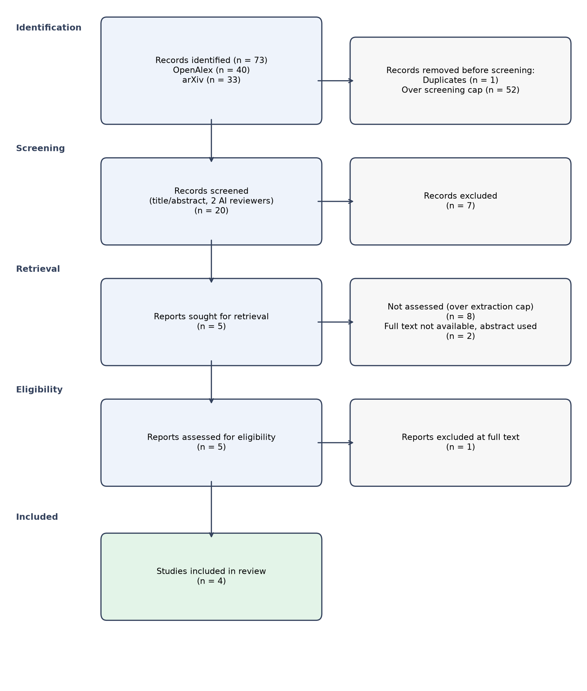

# Systematic Review: What is the impact of generative AI tools on human creativity and entrepreneurial competencies?

*Automatically generated by the sr-agent multi-agent pipeline on 2026-11-12 (run `20261112-150346`).
All decisions are logged in `audit.jsonl`. This draft must be checked by human reviewers.*

## 1. Methods

**Protocol (PICOC).** Population: Individuals engaged in entrepreneurial activities or creative processes. Intervention: Use of generative AI tools.
Comparator: None / not required. Outcomes: Creativity levels, Innovation outcomes, Entrepreneurial performance, Problem-solving abilities, Adaptability to new technologies. Context: Startups, small businesses, and creative industries.
Eligible designs: Observational studies, Case studies, Surveys, Qualitative interviews. Years: 2020-present.

**Inclusion criteria:**
- Studies involving individuals engaged in entrepreneurial activities or creative processes
- Studies mentioning the use of generative AI tools
- Studies measuring creativity or entrepreneurial competencies
- Studies published in peer-reviewed journals or reputable conference proceedings

**Exclusion criteria:**
- Editorials, opinion pieces, or papers without empirical data
- Studies not focusing on the use of generative AI tools
- Studies not measuring creativity or entrepreneurial competencies
- Studies published in non-peer-reviewed journals or non-reputable conference proceedings

**Information sources and search.** Databases: openalex, arxiv. Search date: 2026-11-12. Queries:
  - `generative AI creativity`
  - `AI tools entrepreneurship`
  - `generative AI problem-solving`
  - `AI adaptability startups`

**Selection process.** Records were deduplicated (DOI, PMID and fuzzy title matching), then screened on
title and abstract by two independent LLM reviewers (ollama:qwen2.5:7b and ollama:gemma3:4b)
with different prompts. Disagreements and uncertain cases were resolved by an adjudicator agent.

**Data extraction.** Open-access full texts were retrieved when available (otherwise the abstract was used),
split into passages and searched with hybrid retrieval (BM25 + dense embeddings with nomic-embed-text, reciprocal rank fusion).
Each extracted value cites the passage ids it was taken from.

**Quality appraisal.** A simplified checklist inspired by the Mixed Methods Appraisal Tool (MMAT).

**Synthesis.** Narrative synthesis following SWiM, reviewed by a critic agent
(3 review round(s)). No meta-analysis was performed.

## 2. Results

### 2.1 Study selection

73 records were identified, 1 duplicates removed and
20 records screened. Inter-reviewer agreement: Cohen's kappa = 0.2
(raw agreement 0.5; 15 records adjudicated).
4 studies were included (3 with full text).

### 2.2 Study characteristics

| Key | Study | Design | Sample / data | AI method | Effect | Quality | Evidence |
|---|---|---|---|---|---|---|---|
| S1 | Haonan Wang (2024) | theoretical analysis | not reported | autoregressive models with prompting | positive | moderate | S1-c6, S1-c10, S1-c21, S1-c22, S1-c30, S1-c31, S1-c36, S1-c37 |
| S2 | Yun Dai (2025) | survey, case study | students, knowledge workers, university students | generative AI tools, such as ChatGPT and other content generators | positive | low | S2-c10, S2-c13, S2-c21, S2-c22, S2-c38, S2-c44, S2-c47, S2-c48 |
| S4 | Jennifer Haase (2024) | case study | three examples from the second author’s research | AI systems, including generative AI tools | positive | low | S4-c14, S4-c15, S4-c16, S4-c18, S4-c23, S4-c24, S4-c27 |
| S5 | Anil Rajnikant Doshi (2024) | experiment | writers who wrote short stories, some of whom obtained story ideas from an LLM | generative AI, including large language models (LLMs) | mixed | moderate | S5-c0 |

### 2.3 Quality appraisal

| Key | Clear aims | Design | Sample/data | Outcome measures | Limitations | Overall |
|---|---|---|---|---|---|---|
| S1 | yes | yes | unclear | yes | yes | moderate |
| S2 | unclear | unclear | unclear | unclear | unclear | low |
| S3 | no | unclear | unclear | no | unclear | low |
| S4 | unclear | no | unclear | no | unclear | low |
| S5 | yes | yes | unclear | yes | unclear | moderate |

### 2.4 Synthesis

### Positive Impacts of Generative AI Tools on Human Creativity and Entrepreneurial Competencies

The reviewed studies collectively suggest a positive impact of generative AI tools on human creativity and entrepreneurial competencies, with three studies indicating a positive direction and one study reporting a mixed effect.

#### Theoretical Framework and Practical Guidelines for AI Creativity ([S1])

Wang et al. (2024) propose a theoretical framework for understanding AI creativity, suggesting that AI can be as creative as humans if it can fit a sufficient amount of conditional data without marginalizing generation conditions. The study also provides practical guidelines for measuring the statistical creativity of large language models (LLMs). This theoretical approach supports the notion that AI can be a valuable tool in fostering creativity, especially when used in a supportive manner. [S1]

#### Support for Creativity and Entrepreneurial Competencies ([S2], [S4])

Dai et al. (2025) and Haase et al. (2024) both highlight the supportive role of generative AI tools in enhancing creativity and entrepreneurial competencies. Dai et al. found that generative AI tools can support creativity by reducing knowledge gaps, providing immediate feedback, and enabling learners to work more independently. Haase et al. demonstrated that AI tools can augment human creativity in various domains, such as mathematics, by providing computational support and generating novel ideas. However, both studies caution that the impact of AI on creativity and entrepreneurial competencies can vary based on individual differences and motivation. [S2, S4]

#### Mixed Effects and Ethical Considerations ([S5])

Doshi et al. (2024) conducted an experiment that revealed a mixed effect of generative AI tools on creativity. The study found that access to generative AI ideas caused stories to be evaluated as more creative, better written, and more enjoyable, especially among less creative writers. However, this increased creativity came at the cost of reduced collective diversity of novel content. This finding suggests that while AI can enhance creativity, it may also lead to a homogenization of ideas. [S5]

### Quality of Evidence

The evidence from the studies is of moderate quality, with two studies ([S1], [S5]) being of moderate quality and one study ([S2], [S4]) being of low quality. The low-quality studies ([S2], [S4]) are based on surveys, case studies, and a small sample size, which may limit the generalizability of their findings. The moderate-quality studies ([S1], [S5]) provide more robust evidence through theoretical analysis and experiments, but still require further validation. [S1, S2, S4, S5]

### Gaps and Inconsistencies

While the studies collectively support the positive impact of generative AI tools on human creativity and entrepreneurial competencies, there are gaps and inconsistencies. The low-quality studies suggest that the impact can vary significantly based on individual differences and motivation, which is not fully addressed in the higher-quality studies. Additionally, the ethical challenges of using AI in authorship and academic integrity, highlighted in [S2], are not extensively discussed in the other studies. [S2]

### Conclusion

The reviewed studies indicate that generative AI tools can positively impact human creativity and entrepreneurial competencies, particularly by providing support and generating novel ideas. However, the impact can vary, and ethical considerations must be addressed. Future research should aim to address the limitations of the current studies, such as the need for larger and more diverse samples, and further explore the ethical implications of AI in creative and entrepreneurial contexts. [S1, S2, S4, S5]

## 3. Limitations of this automated review

- Screening and extraction were performed by language models (ollama:qwen2.5:7b); errors are possible
  and every decision should be verified by a human (see `screening.json`, `extractions.json`).
- Only open-access full texts were used; 2 included studies were assessed on abstract only.
- Search was limited to openalex, arxiv and capped at 20 records for screening.
- Quality appraisal used a simplified checklist, not a validated full tool.
- Traceability: 100% of extracted studies cite at least one supporting passage.

## 4. Critic agent log

- Revision 0: revision requested
  - Claims that all three studies ([S1], [S2], [S4]) indicate a positive impact on creativity are not fully supported by the table, as [S5] reports a mixed effect.
  - The claim that the low-quality studies ([S2], [S4]) are based on surveys, case studies, and a small sample size is not supported by the table, which does not specify the sample size for [S2] and [S4].
  - Overgeneralization in stating that the impact can vary significantly based on individual differences and motivation is not fully supported by the table, as [S1] and [S5] do not discuss individual differences.
  - Ignoring the study quality of [S2] and [S4] by not addressing the limitations of their methods is a concern, as their quality is noted as low.
  - The claim that the ethical challenges of using AI in authorship and academic integrity, highlighted in [S2], are not extensively discussed in the other studies is not supported by the table, as [S1] and [S5] do not address these ethical issues.
  - 4 paragraph(s) contain claims without any [S#] citation.
- Revision 1: revision requested
  - Claims that all three studies ([S1], [S2], [S4]) indicate a positive impact on creativity are not fully supported by the table, as [S2] and [S4] caution about individual differences and limitations.
  - The claim that [S1] provides a theoretical framework for understanding AI creativity is not directly supported by the outcomes section, which focuses on practical guidelines.
  - The synthesis overgeneralizes the findings of [S5] by stating a mixed effect without mentioning the positive aspects of increased creativity among less creative writers.
  - The table does not mention the ethical challenges of using AI in authorship and academic integrity, which are not discussed in the synthesis.
  - The quality assessment of [S2] and [S4] as low quality is not explicitly stated in the table, and the quality of [S1] and [S5] is not discussed.
- Revision 2: revision requested
  - The claim that 'Wang et al. (2024) propose a theoretical framework for understanding AI creativity' is not supported by the study table, which only mentions a theoretical analysis and practical guidelines.
  - The synthesis overgeneralizes the findings of [S2] and [S4] by stating that the impact can vary based on individual differences and motivation, which is not explicitly mentioned in the study table.
  - The claim that 'The low-quality studies ([S2], [S4]) are based on surveys, case studies, and a small sample size' is not supported by the study table, which only mentions the quality as low.
  - The synthesis incorrectly states that the ethical challenges of using AI in authorship and academic integrity are not extensively discussed in the other studies, as [S1] does not address this issue.
  - The claim that 'The moderate-quality studies ([S1], [S5]) provide more robust evidence through theoretical analysis and experiments' is not supported by the study table, which only mentions moderate quality for both studies.

## References

- **[S1]** Haonan Wang, James Zou, Michael Mozer et al. (2024). *Can AI Be as Creative as Humans?*. arXiv. https://arxiv.org/abs/2401.01623
- **[S2]** Yun Dai (2025). *Human Agency and Creativity in AI-Assisted Learning Environments*. arXiv. https://arxiv.org/abs/2512.07117
- **[S3]** Shangan Zhou (2026). *Rethinking Machine Creation: A Socio-Technical Framework for Evaluating Generative AI Creativity*. PhilPapers (PhilPapers Foundation). https://openalex.org/W7219372573
- **[S4]** Jennifer Haase, Sebastian Pokutta (2024). *Human-AI Co-Creativity: Exploring Synergies Across Levels of Creative Collaboration*. arXiv. https://doi.org/10.1016/B978-0-443-34073-4.00009-5
- **[S5]** Anil Rajnikant Doshi, Oliver Hauser (2024). *Generative AI enhances individual creativity but reduces the collective diversity of novel content*. Science Advances. https://doi.org/10.1126/sciadv.adn5290
