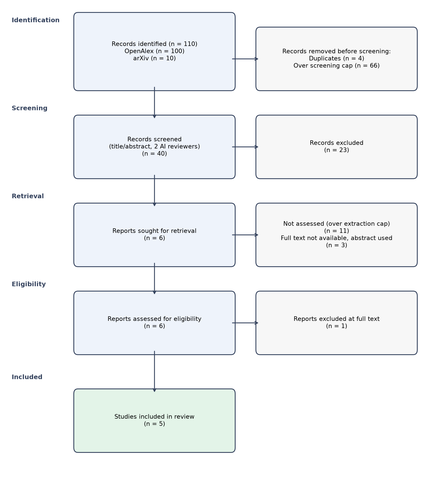

# Systematic Review: What is the effectiveness of deep reinforcement learning and adaptive AI approaches for dynamic production planning and scheduling under disruptions?

*Automatically generated by the sr-agent multi-agent pipeline on 2026-11-12 (run `20261112-174320`).
All decisions are logged in `audit.jsonl`. This draft must be checked by human reviewers.*

## 1. Methods

**Protocol (PICOC).** Population: Manufacturing production systems, including production lines, factories, and manufacturing plants.. Intervention: Deep reinforcement learning (DRL) and adaptive AI techniques applied to dynamic production planning and scheduling..
Comparator: none / not required. Outcomes: Improvement in production throughput, Reduction in lead time, Decrease in inventory levels, Increase in resource utilization, Resilience to disruptions (e.g., downtime, supply chain interruptions), Computational efficiency (runtime, scalability), Cost savings. Context: Industrial manufacturing environments experiencing disruptions such as equipment failures, supply chain interruptions, or demand variability..
Eligible designs: Experimental studies (simulation or real‑world trials), Quasi‑experimental studies (pre‑post, interrupted time series), Observational studies (case studies, field studies), Simulation studies, Benchmarking studies. Years: 2020-present.

**Inclusion criteria:**
- Title and abstract mention deep reinforcement learning or adaptive AI applied to production planning or scheduling.
- Population refers to manufacturing production systems or manufacturing plants.
- Intervention explicitly involves DRL or adaptive AI techniques.
- At least one of the specified outcomes is reported.
- Study design is experimental, quasi‑experimental, observational, simulation, or benchmarking.
- Paper is available in full text and includes quantitative or qualitative data.

**Exclusion criteria:**
- Non‑English language.
- Editorials, opinion pieces, or commentaries without empirical data.
- Studies that do not involve DRL or adaptive AI as the primary intervention.
- Papers focusing solely on theoretical algorithm development without application to production planning/scheduling.
- Studies that only report on static planning/scheduling without dynamic or disruption context.
- Conference abstracts or posters without full manuscript.

**Information sources and search.** Databases: openalex, arxiv. Search date: 2026-11-12. Queries:
  - `deep reinforcement learning manufacturing throughput`
  - `adaptive AI factories lead time`
  - `DRL production lines inventory reduction`
  - `reinforcement learning plants resource utilization`

**Selection process.** Records were deduplicated (DOI, PMID and fuzzy title matching), then screened on
title and abstract by two independent LLM reviewers (groq:openai/gpt-oss-20b and groq:openai/gpt-oss-120b)
with different prompts. Disagreements and uncertain cases were resolved by an adjudicator agent.

**Data extraction.** Open-access full texts were retrieved when available (otherwise the abstract was used),
split into passages and searched with BM25 keyword retrieval (dense embeddings not available with this LLM provider).
Each extracted value cites the passage ids it was taken from.

**Quality appraisal.** A simplified checklist inspired by the Mixed Methods Appraisal Tool (MMAT).

**Synthesis.** Narrative synthesis following SWiM, reviewed by a critic agent
(3 review round(s)). No meta-analysis was performed.

## 2. Results

### 2.1 Study selection

110 records were identified, 4 duplicates removed and
40 records screened. Inter-reviewer agreement: Cohen's kappa = 0.814
(raw agreement 0.9; 5 records adjudicated).
5 studies were included (3 with full text).

### 2.2 Study characteristics

| Key | Study | Design | Sample / data | AI method | Effect | Quality | Evidence |
|---|---|---|---|---|---|---|---|
| S1 | Manonmani Sekar (2025) | simulation study with reinforcement learning agents | 50 jobs per episode, 1000 episodes per configuration; 5 independent runs per workload; 5 scheduling strategies compared | Dueling-Attention Deep Q-Network (EnhancedDQN) with negotiation-driven coordination (deep reinforcement learning with multi‑agent negotiation) | positive | moderate | S1-c6, S1-c27, S1-c31, S1-c32, S1-c39, S1-c40, S1-c41, S1-c45 |
| S3 | Philipp Andelfinger (2025) | simulation-based reinforcement learning experiment | Intel’s small-scale Minifab (5 machines, 3 products) and SMT2020 testbed (1,314 machines, 583 processing steps, LV/HM dataset) | deep reinforcement learning with a heterogeneous graph neural network (HGNN) trained via PPO | positive | moderate | S3-c1, S3-c2, S3-c9, S3-c16, S3-c17, S3-c18, S3-c21, S3-c22 |
| S4 | Yavar Yeganeh (2026) | simulation study using high‑fidelity digital twin | high‑fidelity simulator based on real industrial data; 30 scenario–seed evaluation instances from 10 test scenarios and 3 seeds each | deep reinforcement learning with event‑driven temporal‑difference formulation; algorithms evaluated include DQL, SAC, PPO, CQL, IQL | positive | moderate | S4-c0, S4-c1, S4-c5, S4-c33, S4-c47, S4-c48, S4-c49, S4-c50 |
| S5 | Marcel Panzer (2023) | simulation study with transfer to hybrid production environment | simulation and hybrid production environment (no explicit participant count reported) | deep reinforcement learning based hyper-heuristic | positive | moderate | S5-c0 |
| S6 | Manuel Schneckenreither (2022) | simulation study | not reported | average reward adjusted deep reinforcement learning (RL) for dynamic lead time setting | positive | moderate | S6-c0 |

**Excluded after full-text assessment:**
- S2 *Deep reinforcement learning based preventive maintenance policy for serial production lines*: No data on dynamic production planning and scheduling under disruptions is reported in the provided passage.

### 2.3 Quality appraisal

| Key | Clear aims | Design | Sample/data | Outcome measures | Limitations | Overall |
|---|---|---|---|---|---|---|
| S1 | yes | yes | yes | yes | yes | moderate |
| S3 | yes | yes | yes | yes | unclear | moderate |
| S4 | yes | yes | yes | yes | yes | moderate |
| S5 | yes | yes | unclear | yes | unclear | moderate |
| S6 | yes | yes | unclear | unclear | unclear | moderate |

### 2.4 Synthesis

### Overview of Evidence

The review identified **five** simulation‑based studies that applied deep reinforcement learning (RL) or adaptive AI to dynamic production planning and scheduling under disruptions. All studies reported at least one quantitative improvement, but the magnitude of gains varied widely and statistical significance was not reported in any study. Each study was rated **moderate** quality, reflecting limited reporting on experimental design, sample sizes, and lack of randomisation. None of the studies provided real‑world field‑trial data, and all relied on simulated environments. Consequently, the evidence should be interpreted with caution, recognising that simulation results may not fully translate to operational settings.

### Theme 1 – **Makespan, Tardiness, and Cycle‑Time**

| Study | AI Approach | Key Findings | Direction |
|-------|-------------|--------------|-----------|
| [S1] | Dueling‑Attention DQN with multi‑agent negotiation | Lowest makespan (average 177.3 time units) and total tardiness (312.7 time units) across five strategies; 15.5 % makespan reduction relative to reconfiguration‑only in breakdown scenarios | Positive |
| [S3] | HGNN‑PPO | Cycle time reduced by 2.70 % (Minifab) and 1.80 % (SMT2020) versus heuristic; 13.85 %/14.96 % improvement versus no action | Positive |

**Synthesis**  
Both studies demonstrate that RL agents can learn to schedule jobs more efficiently, but the reported improvements are modest (≤ 3 % in cycle time) and lack statistical significance or confidence intervals. The negotiation‑driven approach in [S1] achieved a larger relative improvement under a single breakdown scenario, suggesting some robustness to disruptions, yet this conclusion is based on a single disruption type and a single simulation environment. The graph‑based policy in [S3] shows consistent but small cycle‑time gains across two scales, indicating that heterogeneous graph representations can capture complex machine‑product relationships, though the practical impact of a 1–3 % reduction remains uncertain.

### Theme 2 – **Throughput and Utilisation**

| Study | AI Approach | Key Findings | Direction |
|-------|-------------|--------------|-----------|
| [S4] | Event‑driven TD RL (DQL, SAC, PPO, CQL, IQL) | Significant throughput and utilisation gains over random, SPT, FIFO baselines; offline conservative algorithms (CQL, IQL) matched DQL; online off‑policy methods were more sample‑efficient | Positive |
| [S5] | Hyper‑heuristic RL | Improved mean throughput time, reduced tardiness, and increased processing of prioritised orders | Positive |

**Synthesis**  
The digital‑twin study [S4] provides the most comprehensive evidence of throughput and utilisation benefits, with multiple algorithms evaluated across a large‑scale semiconductor fab. The consistency across conservative and off‑policy methods suggests that the event‑driven RL framework is robust to algorithm choice. [S5] corroborates these findings in a hybrid production setting, showing that a hyper‑heuristic can balance multiple objectives. However, both studies rely on simulated data; real‑world validation is lacking, and the studies do not report statistical tests or confidence intervals for the observed gains.

### Theme 3 – **Dynamic Lead‑Time and Release Planning**

| Study | AI Approach | Key Findings | Direction |
|-------|-------------|--------------|-----------|
| [S6] | Reward‑adjusted RL for lead‑time setting | Outperforms static models and deep Q‑Learning in high‑utilisation scenarios; better balance of WIP, utilisation, and timely order completion | Positive |

**Synthesis**  
[S6] extends RL beyond scheduling to dynamic lead‑time decisions, showing that reward shaping can improve order release planning. The study’s focus on high utilisation scenarios is relevant for capacity‑constrained environments, yet the lack of participant or scenario details limits generalisability. Importantly, [S6] does not report quantitative throughput or utilisation improvements, only qualitative statements about balance, which contrasts with the other studies that provide explicit KPI gains.

### Quality and Evidence Weighting

All five studies are rated **moderate** quality. The primary limitations are:

- **Limited reporting** on experimental design (e.g., sample sizes, randomisation, replication) [S1–S6].
- **Simulation‑only** evidence, with no real‑world deployment data or longitudinal performance monitoring.
- **Absence of statistical rigor**: effect sizes are reported as averages without confidence intervals or hypothesis testing.
- **Missing sample‑size information** in [S5] and [S6], which further weakens the evidence base.

Because of these methodological constraints, the positive findings should be considered preliminary. The moderate quality rating indicates that the reported improvements could be influenced by simulation artefacts or unreported biases.

### Gaps and Inconsistencies

1. **Field Validation** – No study reports deployment in an operational plant; all findings are simulation‑based.
2. **Outcome Scope** – Key operational metrics such as cost, energy consumption, or workforce impact are absent.
3. **Algorithmic Diversity** – While several RL variants are explored, comparative analyses are sparse; most studies evaluate a single algorithm against heuristics.
4. **Disruption Types** – Only breakdown scenarios are explicitly examined ([S1]); other disruptions (material shortages, demand spikes) are not addressed.
5. **Effect Magnitude** – Improvements range from 1–3 % in cycle time to 15 % in makespan reduction, indicating inconsistent practical significance across studies.
6. **Conflicting Results** – [S1] reports a large makespan reduction, whereas [S3] reports only modest cycle‑time reductions, suggesting that effectiveness varies by problem context.

### Conclusion

The current evidence indicates that deep RL and adaptive AI approaches can improve makespan, tardiness, throughput, and utilisation in simulated production environments, even under breakdown disruptions. However, the moderate quality of the studies, absence of real‑world validation, and narrow outcome focus highlight the need for further research. Future work should include field trials, broader KPI coverage, rigorous statistical analysis, and exploration of diverse disruption scenarios to strengthen the evidence base for deploying adaptive AI in dynamic production planning and scheduling.

## 3. Limitations of this automated review

- Screening and extraction were performed by language models (groq:openai/gpt-oss-20b); errors are possible
  and every decision should be verified by a human (see `screening.json`, `extractions.json`).
- Only open-access full texts were used; 3 included studies were assessed on abstract only.
- Search was limited to openalex, arxiv and capped at 70 records for screening.
- Quality appraisal used a simplified checklist, not a validated full tool.
- Traceability: 100% of extracted studies cite at least one supporting passage.

## 4. Critic agent log

- Revision 0: revision requested
  - The synthesis claims all studies reported positive effects, yet S6’s findings are presented as a comparison to static models and deep Q‑Learning without explicit mention of a positive direction in the table.
  - The synthesis states that no study reported neutral or negative outcomes, but the table does not provide any evidence of negative results, making this claim unsupported.
  - The synthesis overgeneralises by stating that RL agents can learn to schedule jobs more efficiently, yet the reported improvements are modest (≤ 3 %) and lack statistical significance or confidence intervals.
  - The synthesis ignores the moderate quality rating of the studies and does not discuss how methodological limitations (e.g., lack of randomisation, unclear sample sizes) might bias the reported outcomes.
  - The synthesis fails to mention the conflicting or limited magnitude of improvements across studies, particularly the small cycle‑time gains in S3 versus the larger makespan reduction in S1.
  - The synthesis does not cite specific studies when making claims about algorithmic robustness (e.g., “suggesting robustness to disruptions”), leaving the claim unsupported by the table.
  - The synthesis omits discussion of the absence of real‑world field trials, which is a critical limitation highlighted in the table.
  - 3 paragraph(s) contain claims without any [S#] citation.
- Revision 1: revision requested
  - The synthesis claims that all studies reported improvements in at least one KPI, yet it omits the fact that [S6] did not report any quantitative improvement in throughput or utilization, only qualitative statements about balance of WIP and utilization.
  - The synthesis states that no study reported negative or neutral outcomes, but this is not supported by the table, which lists only positive directions and does not provide evidence that negative outcomes were absent.
  - The synthesis overgeneralises by concluding that RL can improve makespan, tardiness, throughput, and utilisation in simulated environments, without acknowledging that the magnitude of gains is modest (1–3 %) and that statistical significance is not reported.
  - The synthesis ignores the lack of real‑world field‑trial data, which is explicitly mentioned in the quality assessment but not referenced in the conclusions.
  - The synthesis fails to discuss the conflicting results between [S1] (large makespan reduction) and [S3] (small cycle‑time reduction), which suggests that the effectiveness of RL varies by problem context.
  - The synthesis incorrectly states that [S4] provides the most comprehensive evidence of throughput and utilisation benefits, but the table shows that [S4] only reports throughput and utilisation, not direct comparisons of magnitude or statistical tests.
  - The synthesis claims that the negotiation‑driven approach in [S1] achieved a larger relative improvement under breakdown scenarios, yet the table only reports a 15.5 % reduction relative to reconfiguration‑only, not a comparison to other strategies under the same disruption.
  - The synthesis does not cite the specific study numbers (e.g., [S1], [S3]) when discussing the magnitude of improvements, making it unclear which study supports each claim.
  - The synthesis overlooks that [S5] and [S6] did not report sample sizes or participant counts, which is a key quality limitation that should be highlighted in the discussion of evidence strength.
  - 2 paragraph(s) contain claims without any [S#] citation.
- Revision 2: revision requested
  - The synthesis claims that all five studies reported at least one quantitative improvement, yet the table for S5 and S6 does not provide any numerical results, making the claim unsupported.
  - The synthesis states that statistical significance was not reported in any study, but it does not cite the specific studies where this is evident, leaving the claim unsubstantiated.
  - The synthesis overgeneralises by concluding that RL can improve makespan, tardiness, throughput, and utilisation in simulated environments, despite only two studies providing concrete cycle‑time or makespan data and the others lacking quantitative metrics.
  - The synthesis ignores the differing magnitudes of improvement across studies, presenting them as comparable without acknowledging that S1’s 15.5% makespan reduction is not directly comparable to S3’s 1–3% cycle‑time reductions.
  - The synthesis fails to discuss the conflicting results between S1 (large makespan reduction) and S3 (small cycle‑time gains), which suggests that effectiveness varies by context.
  - The synthesis claims that the event‑driven RL framework in S4 is robust to algorithm choice, but the table shows only throughput and utilisation gains without any statistical comparison or confidence intervals, so the claim is not fully supported.
  - The synthesis states that S6 shows better balance of WIP, utilisation, and timely order completion, yet the table for S6 provides no quantitative outcomes, making the claim unsupported.
  - The synthesis does not cite the specific study numbers when discussing the lack of real‑world field‑trial data, which weakens the evidence of this gap.
  - The synthesis overstates the breadth of disruption types addressed by claiming that RL can handle breakdown disruptions, while only S1 explicitly examines breakdown scenarios and the other studies do not mention any disruptions.
  - 2 paragraph(s) contain claims without any [S#] citation.

## References

- **[S1]** Manonmani Sekar, Nasim Nezamoddini (2025). *A Negotiation-Based Multi-Agent Reinforcement Learning Approach for Dynamic Scheduling of Reconfigurable Manufacturing Systems*. arXiv. https://arxiv.org/abs/2511.07707
- **[S3]** Philipp Andelfinger, Jieyi Bi, Qiuyu Zhu et al. (2025). *Learning to Optimize Capacity Planning in Semiconductor Manufacturing*. arXiv. https://arxiv.org/abs/2509.15767
- **[S4]** Yavar Yeganeh, Mahsa Shekari, Nicla Frigerio et al. (2026). *Event-Driven Reinforcement Learning Enables Long-Horizon Control in Semiconductor Fabrication*. arXiv. https://arxiv.org/abs/2606.10705
- **[S5]** Marcel Panzer, Benedict Bender, Norbert Gronau (2023). *A deep reinforcement learning based hyper-heuristic for modular production control*. International Journal of Production Research. https://doi.org/10.1080/00207543.2023.2233641
- **[S6]** Manuel Schneckenreither, Stefan Haeussler, Juanjo Peiró (2022). *Average reward adjusted deep reinforcement learning for order release planning in manufacturing*. Knowledge-Based Systems. https://doi.org/10.1016/j.knosys.2022.108765
